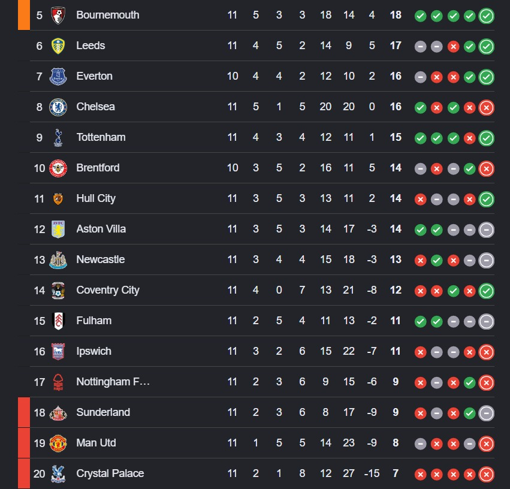

# IF3170_G09_Aduhmen

Tugas Besar 2 IF3170 Inteligensi Artifisial. Kami mengimplementasikan algoritma *supervised learning* dari nol untuk memprediksi apakah sebuah pemesanan penginapan akan dibatalkan (`is_canceled`).

Ada lima model: KNN, Naive Bayes, Logistic Regression, Decision Tree Learning (DTL), dan SVM. Hasil tiap model dibandingkan dengan versi scikit-learn.

## Struktur

```
data/      dataset Kaggle (train.csv, test.csv, sample_submission.csv)
docs/      laporan (Laporan_IF3170_G09_Aduhmen.pdf)
src/
  models/       implementasi model from scratch
  experiments/  skrip eksperimen per model
  utils/        metrik, simpan/muat model, plot
  preprocessing.py
  notebook.ipynb
output/    figur, model (.pkl), submisi, hasil CV
```

## Menjalankan

```bash
pip install -r requirements.txt
jupyter notebook src/notebook.ipynb
```

Atau jalankan eksperimen per model dari root repo:

```bash
python -m src.experiments.run_svm_experiment   # ganti svm dengan knn / naive_bayes / logreg / dtl
```

## Kelompok 09 (Aduhmen)

| Nama | NIM |
|---|---|
| Ardell Aghna Mahendra | 13523151 |
| Fazri Arrashyi Putra | 13524127 |
| Dika Pramudya Nugraha | 13524132 |
| Daniel Putra Rywandi S. | 13524143 |
| Dzakwan Muhammad Khairan Putra Purnama | 13524145 |


